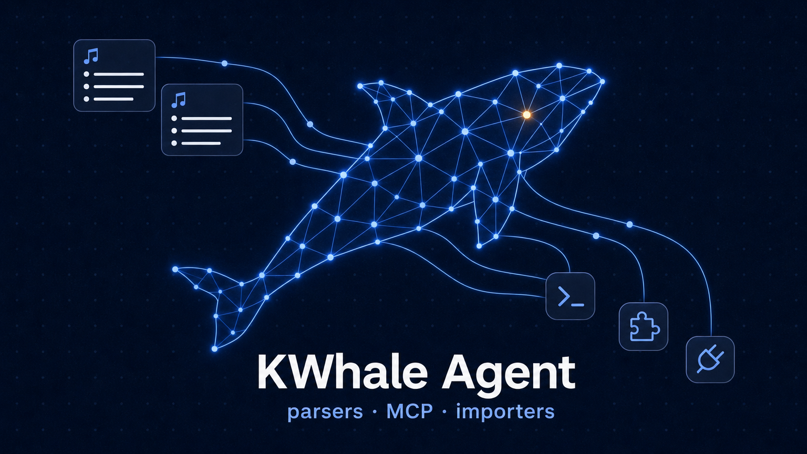
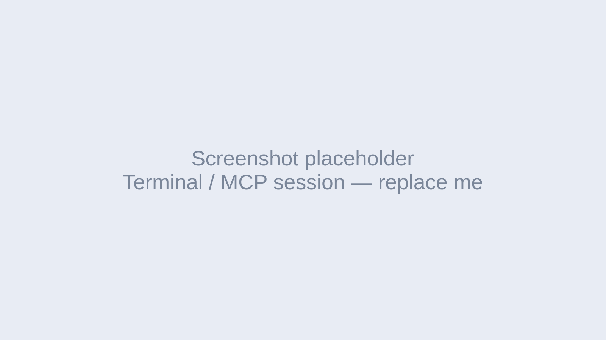

<div align="center">

**English** | [Русский](README.ru.md)

<br/>



# KWhale Agent

**The agent layer for KWhale — playlist parsers, an MCP server, and a portable skill pack.**

[](LICENSE)
[](https://www.python.org/)
[](https://modelcontextprotocol.io/)

</div>

Everything an LLM agent needs to manage a user's music collection on a
[KWhale Server](https://github.com/KWhale-Music/kwhale-server): standalone playlist
parsers (Yandex Music, SoundCloud, YouTube Music, VK, text/CSV/M3U lists, `yt-dlp`
fallback), a parallel-matching importer, a full-featured **MCP server**, and a
**portable skill pack** that works with any agent — with or without MCP.

## ✨ Features

- **Standalone playlist parsers** — no server dependency; public Yandex Music playlists
  (with redirect following and >150-track hydration), SoundCloud `api-v2` (with `client_id`
  scraping and `on.soundcloud.com` redirects), YouTube Music InnerTube, VK `audio.get`,
  plain `Artist - Title` lists, Exportify/Spotify CSV, M3U/M3U8, and a universal
  `yt-dlp` fallback with optional proxy.
- **Smart importer** — parallel track matching (ISRC + duration + text fallback) into a
  new or existing playlist, with `dry_run`.
- **MCP server** (`python -m kwhale_agent.mcp_server`) — ~30 tools: auth, playlist CRUD,
  catalog search, likes, downloads, uploads, mixes, share links.
- **Portable skill pack** — `kwhale-api` (raw `/v1` protocol, works without MCP),
  `kwhale-ops` (operational scenarios), `kwhale-codebase`, `kwhale-connectors`,
  `kwhale-proxy` (sing-box / proxy routing for sources).
- **Isolated test stand** — the whole test suite runs without network and without a database.

## 📸 Screenshots



## 🚀 Quickstart

```bash
git clone https://github.com/KWhale-Music/kwhale-agent.git
cd kwhale-agent
python3 -m venv .venv
.venv/bin/pip install -e ".[dev,fallback]"   # httpx[socks], fastmcp, pytest, yt-dlp

.venv/bin/python -m pytest tests -v          # offline test suite
.venv/bin/python -m kwhale_agent.mcp_server  # start MCP (stdio)
```

Connect to your agent: copy or symlink `skills/*` into your agent's skills directory
(e.g. `.opencode/skills/`), and register the MCP server in its config.
For an external agent **without MCP**, ship `skills/kwhale-api/SKILL.md` — the agent
asks the user for the instance URL and credentials itself.

## ⚙️ Configuration

| Variable | Purpose |
|---|---|
| `KWHALE_BASE_URL` | instance API URL with `/v1` (e.g. `http://127.0.0.1:19001/v1`) |
| `KWHALE_EMAIL` / `KWHALE_PASSWORD` | account credentials (login is by **email**) |
| `KWHALE_DOWNLOAD_DIR` | target for `download_track(mode="file")` (default `./downloads`) |
| `KWHALE_AGENT_VK_TOKEN` | VK token for `VkPlaylistParser` |
| `HTTPS_PROXY` / `YTDLP_PROXY` | proxy for parsers and `yt-dlp` fallback (see `kwhale-proxy` skill) |

If the env is empty, the agent should ask the user and call MCP `login(email, password, base_url)`.

## 🧭 MCP tools

- **Auth & info:** `login`, `logout`, `kwhale_status`
- **Playlists & import:** `list_supported_platforms`, `detect_playlist_platform`,
  `parse_playlist`, `parse_track_list`, `import_playlist_to_profile` (`dry_run`)
- **Playlist CRUD:** `list_playlists`, `get_playlist` (full pagination for 200+ tracks),
  `create_playlist`, `update_playlist`, `delete_playlist`, `add_tracks_to_playlist`,
  `remove_track_from_playlist`, `reorder_playlist_tracks`, `like_playlist_tracks`
- **Catalog & downloads:** `search_tracks` (`wait=true`), `get_track_details`, `like_track`,
  `download_track`, `download_status`, `upload_track`, `manage_enrichments`, `list_library`
- **Mixes & share:** `list_mixes`, `get_mix_tracks`, `prompt_mix`, `create_share_link`

## 🏗 Structure

```
kwhale_agent/
├── playlists/      # standalone parsers (yandex, soundcloud, ytm, vk, textlist, ytdlp fallback)
├── bridge.py       # async HTTP bridge to the /v1 API
├── importer.py     # parallel ISRC/duration/text matching importer
└── mcp_server.py   # stdio MCP server
skills/             # portable skill pack for any LLM agent
tests/              # isolated, network-free test stand
```

## 🧭 Author's review

*Honest notes from the author — trade-offs and open rough edges.*

What I'm genuinely happy with:

- **Parsers are standalone.** They don't import the server and don't need a database —
  you can use this repo purely to scrape playlists into CSV and be happy.
- **The offline test stand.** A test suite that runs with zero network and zero services
  is the reason this repo is pleasant to change.
- **The skill pack idea.** `kwhale-api` lets any agent drive KWhale over plain HTTP with
  no MCP at all — portability beats integration depth here.

What's honestly still rough:

- **External APIs are fragile by nature.** The VK and YouTube Music parsers depend on
  undocumented endpoints; expect them to break occasionally and be fixed.
- **`yt-dlp` is a heavy fallback.** It works almost everywhere, but it drags a large
  dependency behind it — hence the `[fallback]` extra being optional.
- **Test coverage is uneven** — parsers and importer are well covered; the MCP surface
  is thinner.

## 🗺 Status

Beta — used by the author to migrate real playlists between services.

## 📄 License

[AGPL-3.0](LICENSE) — same terms as the server.

Third-party notes: parsers integrate third-party services through their existing web APIs.
Use them in accordance with the terms of those services; the authors take no responsibility
for misuse.
