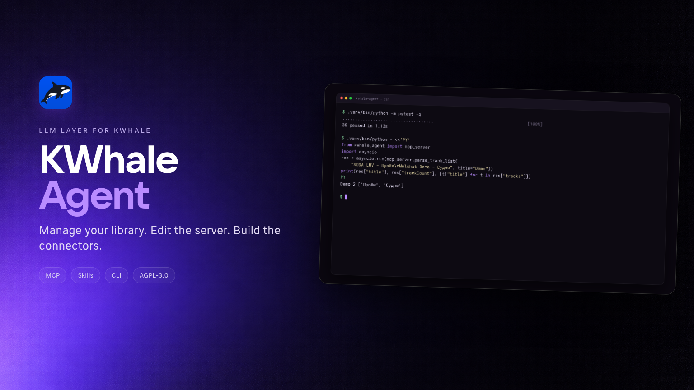
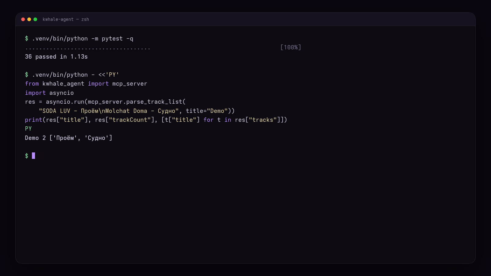

<div align="center">

[English](README.md) | **Русский**

<br/>



# KWhale Agent

**Агент-слой KWhale — управление библиотекой, редактирование сервера, парсеры и MCP.**

[](LICENSE)
[](https://www.python.org/)
[](https://modelcontextprotocol.io/)
[](https://github.com/KWhale-Music/kwhale-agent/actions/workflows/ci.yml)

</div>

Всё, что LLM-агенту нужно для работы с [KWhale Server](https://github.com/KWhale-Music/kwhale-server):
управление музыкальной коллекцией, **редактирование кода сервера** и **создание коннекторов**
под любые сервисы. Внутри — standalone-парсеры плейлистов (Яндекс Музыка, SoundCloud,
YouTube Music, VK, списки текстом/CSV/M3U, fallback через `yt-dlp`), импортёр с
параллельным матчингом, полноценный **MCP-сервер** и **переносимый пак скиллов**,
работающий с любым агентом — с MCP или без него.

## Возможности

- **Управление библиотекой** — поиск, плейлисты, лайки, загрузки, аплоады, миксы и шеринг-ссылки
  через MCP или обычный HTTP `/v1`.
- **Standalone-парсеры плейлистов** — без зависимости от сервера; публичные плейлисты
  Яндекс Музыки (с редиректами и догидрацией >150 треков), SoundCloud `api-v2`
  (со скрейпом `client_id` и редиректами `on.soundcloud.com`), YouTube Music InnerTube,
  VK `audio.get`, простые списки `Artist - Title`, CSV Exportify/Spotify, M3U/M3U8
  и универсальный fallback через `yt-dlp` с опциональным прокси.
- **Умный импортёр** — параллельный матчинг треков (ISRC + длительность + текстовый
  fallback) в новый или существующий плейлист, с `dry_run`.
- **Редактирование кода** — скилл `kwhale-codebase` даёт LLM карту сервера, Android-клиента
  и агент-слоя, команды сборки/тестов и инварианты. Агент может менять код, а не только
  управлять библиотекой.
- **Создание коннекторов** — скилл `kwhale-connectors` — полное руководство по контракту,
  регистрации, стримам, секретам и тестам. Достаточно, чтобы написать коннектор под любой
  сервис с нуля.
- **MCP-сервер** (`python -m kwhale_agent.mcp_server`) — ~30 тулз: auth, CRUD плейлистов,
  поиск по каталогу, лайки, загрузки, аплоады, миксы, шеринг-ссылки.
- **Переносимый пак скиллов** — `kwhale-api` (сырой `/v1` протокол, работает без MCP),
  `kwhale-ops` (операционные сценарии), `kwhale-codebase`, `kwhale-connectors`,
  `kwhale-proxy` (sing-box / проксирование источников).
- **Изолированный тест-стенд** — весь сьюит запускается без сети и без базы данных.

## Скриншоты



## Быстрый старт

```bash
git clone https://github.com/KWhale-Music/kwhale-agent.git
cd kwhale-agent
python3 -m venv .venv
.venv/bin/pip install -e ".[dev,fallback]"   # httpx[socks], fastmcp, pytest, yt-dlp

.venv/bin/python -m pytest tests -v          # оффлайн-тесты
.venv/bin/python -m kwhale_agent.mcp_server  # запуск MCP (stdio)
```

Подключение к агенту: скопируйте или прилинкуйте `skills/*` в каталог скиллов своего
агента (например `.opencode/skills/`) и зарегистрируйте MCP-сервер в его конфиге.
Для внешнего агента **без MCP** достаточно скилла `skills/kwhale-api/SKILL.md` —
агент сам спросит у пользователя URL инстанса и учётные данные.

## Конфигурация

| Переменная | Назначение |
|---|---|
| `KWHALE_BASE_URL` | API URL инстанса с `/v1` (например `http://127.0.0.1:19001/v1`) |
| `KWHALE_EMAIL` / `KWHALE_PASSWORD` | учётные данные (вход по **email**) |
| `KWHALE_DOWNLOAD_DIR` | каталог для `download_track(mode="file")` (дефолт `./downloads`) |
| `KWHALE_AGENT_VK_TOKEN` | токен VK для `VkPlaylistParser` |
| `HTTPS_PROXY` / `YTDLP_PROXY` | прокси для парсеров и `yt-dlp` fallback (скилл `kwhale-proxy`) |

Если env пуст — агент должен спросить у пользователя и вызвать MCP `login(email, password, base_url)`.

## MCP-тулзы

- **Auth и инфо:** `login`, `logout`, `kwhale_status`
- **Парсинг и перенос плейлистов:** `list_supported_platforms`, `detect_playlist_platform`,
  `parse_playlist`, `parse_track_list`, `import_playlist_to_profile` (`dry_run`)
- **CRUD плейлистов:** `list_playlists`, `get_playlist` (полная пагинация >200 треков),
  `create_playlist`, `update_playlist`, `delete_playlist`, `add_tracks_to_playlist`,
  `remove_track_from_playlist`, `reorder_playlist_tracks`, `like_playlist_tracks`
- **Каталог и загрузки:** `search_tracks` (`wait=true`), `get_track_details`, `like_track`,
  `download_track`, `download_status`, `upload_track`, `manage_enrichments`, `list_library`
- **Миксы и шеринг:** `list_mixes`, `get_mix_tracks`, `prompt_mix`, `create_share_link`

## Структура

```text
kwhale_agent/
├── playlists/           # независимые парсеры (yandex, soundcloud, ytm, vk, textlist, ytdlp fallback)
├── bridge.py            # async HTTP-мост в /v1 API
├── importer.py          # параллельный матч (ISRC + duration + fallback)
└── mcp_server.py        # stdio MCP-сервер
skills/                  # переносимый пак скиллов для любого LLM-агента
tests/                   # изолированный тест-стенд без сети и БД
```

## Статус

Бета.

## Лицензия

[AGPL-3.0](LICENSE) — те же условия, что у сервера.

Исключение — шрифты (если поставляются с репозиторием): они остаются под своими
лицензиями и не покрываются AGPL.

## Сторонние сервисы

Парсеры работают со сторонними сервисами через их существующие веб-API. Используйте их
в соответствии с условиями этих сервисов; авторы не несут ответственности за
ненадлежащее использование.
